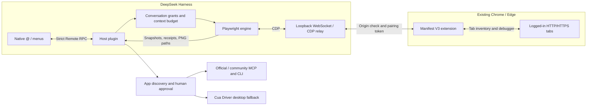

# dsh-doyourweb

Reference and control your existing, logged-in Chrome and Edge tabs from DeepSeek Harness, with compact page context and batched browser actions.

Version `0.1.2` adds element annotations sent directly to the current conversation and `@` references to running Windows apps. App control prefers a task-matching official MCP/CLI, then reviewed community connectors, with desktop control as the fallback. First connections and installations require confirmation. See [annotations and app control](docs/annotations-and-apps.md#english).

[](https://github.com/SheepofSheep/dsh-doyourweb/actions/workflows/ci.yml)
[](LICENSE)
[](package.json)
[](package.json)

English | [简体中文](README.zh-CN.md)

[Local Demo](#local-demo) · [Quick Start](#quick-start) · [Usage](#usage)


*The local pairing page connects your browser extension to the DSH plugin.*

---

## 01 · Introduction

Browser tasks often depend on pages you have already opened and accounts you have already signed into. dsh-doyourweb connects those tabs to DeepSeek Harness instead of launching a separate automation browser or exporting cookies.

The project has two parts: a DSH plugin and a companion Manifest V3 extension. The plugin adds browser references to the native `@` and `/` menus; the extension supplies tab metadata and browser control. Once paired, the extension reconnects in the background without keeping its popup open.

Current version: **0.1.2** for both the package and browser extension. See the [changelog](CHANGELOG.md).

## 02 · Preview

1. Use `/browser` to open the connection page and locate the extension folder.
2. Load the extension in Chrome or Edge, then approve its matching four-digit pairing code.
3. Select an existing page with `@` and describe the task in DSH.

The screenshot above shows the pairing interface, not a recorded automation run.

<a id="local-demo"></a>

### Local Demo

There is no public hosted demo. After the DSH plugin starts, its default local connection page is [http://127.0.0.1:43187/setup](http://127.0.0.1:43187/setup). Browser control runs through this local bridge and the installed extension.

## 03 · Core Features

| Feature | Current behavior |
| --- | --- |
| Existing tabs | Reuses regular HTTP/HTTPS tabs and their login state in Chrome and Edge. |
| Native references | Lists page titles, sites and icons through DSH's `@` and `/` menus. |
| Compact reading | Accessibility snapshots support selector/query narrowing and cursor pagination. Initial reference context shares a default 2,400-character budget. |
| Batched actions | Runs up to 12 typed actions per call; stops on failure or navigation. |
| Result extraction | Returns selected `text`, `value` and `href` fields, with up to 20 rows per extraction. |
| Short receipts | `observe: "summary"` skips the next page snapshot. Action results have a 1,600-character output budget. |
| Screenshots | Saves PNG files locally and returns their paths instead of embedding base64. |
| Background connection | Saves pairing settings, reconnects automatically, and releases idle debugger connections. |
| Element annotations | Pick an element and send a comment, selector, styles, bounds and optional cropped screenshot directly to the current conversation. No separate annotation library. |
| Running apps | Search visible Windows application windows with `@`, with cached program icons. References include process lifetime and window identity. |
| MCP / CLI | Known official connectors, MCP Registry and npm CLI discovery, stdio / Streamable HTTP, and reviewed custom configurations. |
| Installation approval | Native DSH questions or a local `/apps` page; exact package versions and npm lifecycle scripts disabled. Optional repeat-install bypass is restricted to reviewed, trusted sources. |
| Desktop fallback | Cua Driver MCP, bounded text-only reads by default, on-demand images, cached checks and explicit stops for closed windows or repeated polling. |
| Mouse input | `app_mouse` batches up to 8 clicks, double/right clicks, scrolls and drags from one visual snapshot; separate foreground approval. |

Browser budgets count JavaScript characters, including JSON escaping and metadata. App tool `limit` values bound body text; status, steps and image-path metadata are additional. MCP results omit duplicate JSON, and CLI stdout/stderr share one body budget. Character counts are not model tokens, and output budgets do not limit DOM traversal time.

### WebMCP-First Control (Experimental)

Version `0.1.1` checks for page-provided WebMCP tools before collecting a DOM snapshot. It prefers tools that cover the task, falls back to DOM when needed, and reuses unchanged catalogs and validators. Successful calls return a fresh token for the next call without relisting schemas. WebMCP requires a compatible browser API and site-provided tools; ordinary pages keep using DOM automation. See the [experiment guide](docs/webmcp-experiment.md) for requirements, tools and local browser tests.

## 04 · Architecture

| Layer | Technology |
| --- | --- |
| DSH host plugin | Node.js 22+, JavaScript ESM, Cordis integration |
| Native client UI | React and DSH UI primitives |
| Browser engine | Playwright Core 1.64.0, Chrome DevTools Protocol |
| Site tools | `document.modelContext`, Ajv 8.20.0 argument validation |
| Local bridge | WebSocket (`ws`), Zod validation |
| Browser extension | Manifest V3, `chrome.tabs`, `chrome.debugger` |
| App connectors | Official MCP SDK 1.32.1, stdio / Streamable HTTP, literal CLI argument arrays |
| Build and checks | esbuild, Node.js test runner, GitHub Actions |



Only tabs referenced by the user in the current conversation are available to the model's browser tools. Page content is treated as untrusted data, not instructions or permission.

<a id="quick-start"></a>

## 05 · Quick Start

### Requirements

- Node.js 22+ and npm.
- DeepSeek Harness; plugin API compatibility has been checked against `0.2.0-rc.2`.
- Chromium-based Chrome or Edge 125+, with developer mode available for loading an unpacked extension.

### Install the DSH Plugin

For npm installation, open **Plugins > Add Plugin** in DSH, select the **official npm registry**, and enter:

```text
dsh-doyourweb
```

This requires a published package. If the registry returns `404`, use the local installation below. Mirrors may take time to sync a newly published version.

### Build and Install Locally

```sh
git clone --branch ver0.1.2 https://github.com/SheepofSheep/dsh-doyourweb.git
cd dsh-doyourweb
npm ci
npm run build
```

In DSH, open **Plugins > Add Plugin** and enter the **absolute path to this built project directory**. The bridge starts when the plugin activates. No separate development server is required.

### Connect the Browser

1. Enter `/browser` in DSH and open the local connection page.
2. Open `edge://extensions` or `chrome://extensions`, enable developer mode, and load the project's `extension/` folder as an unpacked extension.
3. Compare the extension's four-digit badge code with the pending request on the connection page, then approve it.
4. Return to DSH, select a tab with `@`, and send your request.

The extension popup and pairing page do not need to remain open. Installing the DSH plugin does not install the browser extension automatically.

After upgrading the DSH plugin, fully quit DSH from its tray/background process and relaunch it so the new host module is loaded.

### Configuration

Defaults are declared in [cordis.patch.yml](cordis.patch.yml):

| Setting | Default | Purpose |
| --- | --- | --- |
| `port` | `43187` | Local bridge port |
| `snapshotChars` | `2400` | Page-read and initial reference-context budget |
| `idleTimeoutMs` | `120000` | Idle time before releasing the debugger connection |

The data directory is `<DSH_HOME>/browser-tabs/`, or `~/.dsh/browser-tabs/` when `DSH_HOME` is unset. An explicit plugin `home` setting takes precedence. Set environment variables on the DSH process; the plugin does not require its own model API key.

<a id="usage"></a>

### Usage

After referencing a page, you can ask:

> Read the result list on this page and collect its titles and links. Do not submit any forms.

| Model tool | Use |
| --- | --- |
| `browser_read` | Default `mode: "auto"` discovers WebMCP tools first, otherwise returns a DOM snapshot. Use `mode: "dom"` when site tools do not cover the task; narrow with `selector`, `query` or `depth`. `cursor` paginates DOM content; `limit` accepts 400-8,000 characters. |
| `browser_act` | Use the latest snapshot ID to click, fill, press, select, check, hover, scroll, navigate, go back/forward, wait or extract. |
| `browser_capture` | Save a screenshot when visual inspection is needed. |
| `browser_webmcp_list` | Discover or narrow page tools with `query`; reuse an existing catalog while it remains valid. |
| `browser_webmcp_call` | Call a matching page tool using `catalog`, `name` and `arguments`; success returns `nextCatalog` for another call. |

When multiple tabs are authorized, pass the selected tab's reference as `tab`.

### Annotations and App Control

After installing or upgrading, fully exit DSH from the system tray, restart it, and reload the browser extension. For local development, build this working tree and install its absolute directory path. Do not enable the npm copy and local copy on the same port.

- **Annotations:** choose “批注当前页面” in the extension popup, or ask DSH to enable annotations on a referenced tab. Pick an element, write a comment, then click “添加到会话”. The annotation becomes a queued user message in the conversation shown on the toolbar, with an optional image attachment. The plugin keeps no annotation files or library. Controlled pages also show a top-right annotation button.
- **Apps:** select a running application with `@Unity` or another program name. DSH discovers connectors with `app_discover`, requests connection/installation through `app_connect`, then invokes MCP tools or CLI arguments with `app_call`. A connector found outside discovery can be proposed with its source documentation for human review.
- **Management:** `/apps` opens the local application, connector and approval manager. It need not remain open. Files, folders and conversations in `@` each show three previews with expand/collapse controls; individual folders retain native navigation.
- **Fallback:** `app_desktop` uses upstream Cua Driver when structured tools cannot cover the task. Default reads return bounded controls without screenshots. Use `screenshot: true` only for visual grounding; `app_mouse` then supports up to 8 known-target clicks, scrolls or drags without intermediate captures. Missing windows and repeated inspections return `stop: true`. It does not bypass OS permissions.

See [installation policy, Unity requirements and limitations](docs/annotations-and-apps.md#english).

<details>
<summary>Tool example: read a page, then extract a short result list</summary>

Call `browser_read` for the single authorized tab:

```json
{
  "mode": "dom",
  "depth": 8,
  "limit": 2400
}
```

Use the returned snapshot ID in `browser_act`. Replace the selector with one from the actual page:

```json
{
  "snapshot": "<latest snapshot ID>",
  "observe": "summary",
  "steps": [
    {
      "op": "extract",
      "selector": "a.result-title",
      "fields": ["text", "href"],
      "maxRows": 10
    }
  ]
}
```

These are model-tool arguments, not shell commands. `summary` does not return a new snapshot; read again before another action call.

</details>

## 06 · Structure and Technical Details

```text
src/
  host.js            Plugin lifecycle, tools and conversation context
  client.js          Native mention and slash-menu sources
  client-entry.js    React UI and icons
  bridge.js          Pairing, extension connection and CDP relay
  engine.js          Snapshots, actions, extraction and screenshots
  annotations.js     Isolated element picker and direct conversation delivery
  apps/              App inventory, discovery, approval, installation and execution
  manage.js          Local application and connector management UI
  webmcp.js          Site-tool discovery, routing, validation and calls
  grants.js          Conversation-scoped tab authorization
  protocol.js        Tab references and Remote RPC descriptors
  output.js          Serialized output budgeting
  vendor/            Adapted Playwright browser model
extension/           Manifest V3 extension and popup
scripts/             Build, integration and compatibility checks
test/                Unit tests and fixtures
docs/setup-page.png  Pairing-page screenshot
cordis.patch.yml     DSH plugin registration and defaults
lib/                 Generated build output, not tracked in Git
```

**Snapshots and actions.** Full snapshot text is cached locally for pagination. Element references require a current snapshot; reads, actions and navigation can invalidate previous references. Calls are serialized per tab. Cancellation reports completed or uncertain steps rather than promising rollback.

**Connection lifetime.** Idle connections detach the debugger without closing the tab. A later read reconnects. Restarting the browser changes tab-reference sessions, so select the page again with `@`.

**Data handling.** Pairing credentials and authorization records live in the local data directory; screenshots are stored under `captures/`. Referenced page excerpts enter DSH's model context and may be sent to your configured model provider. Keep pairing files and screenshots private. Purchases, destructive actions and sensitive submissions require explicit user authorization; the plugin does not provide a separate transaction-confirmation dialog.

<details>
<summary>Development checks</summary>

```sh
npm run build
npm test
npx playwright-core install chromium
npm run test:browser
npm run verify:dsh -- --asar "<path to DeepSeek Harness app.asar>"
```

CI is configured for unit tests on Windows and Linux, plus isolated headless Chromium integration on Linux. The badge links to the actual workflow result. Headless checks do not replace end-to-end validation of a daily browser profile and the native DSH UI.

</details>

## 07 · Roadmap / FAQ / License

### Roadmap

Version `0.1.2` includes page annotations, app references and MCP/CLI-first app control. Further work focuses on real-application compatibility and connector configuration. No release date is promised. Report bugs and discuss changes in [Issues](https://github.com/SheepofSheep/dsh-doyourweb/issues).

### FAQ

**Do I have to open the extension every time?** No. Pair once; the extension reconnects in the background. Reload it after updating its files.

**Why are some pages missing?** Only regular HTTP/HTTPS tabs are exposed. Browser-internal and incognito pages are excluded. Check that the extension is enabled and paired if no tabs appear.

**What if port 43187 is already in use?** Avoid activating two plugin copies on the same port. Stop the duplicate bridge or change the plugin's `port` setting and reconnect the extension to that port.

**What are the current limits?** The companion extension is loaded unpacked, not installed from a browser store. Firefox and Safari are not supported. Host API compatibility has been checked against DSH `0.2.0-rc.2`; other versions and native UI workflows need their own verification.

### Contributing and License

Issues and pull requests are welcome. Include reproduction steps and relevant DSH/browser versions; remove tokens, private page contents and account data from logs. For code changes, run the checks relevant to the affected behavior.

Project code is licensed under [MIT](LICENSE). Playwright-derived code and Lucide artwork retain their respective licenses; see [NOTICE](NOTICE), [Apache-2.0](extension/APACHE-2.0.txt) and [ISC](extension/icons/LICENSE).
