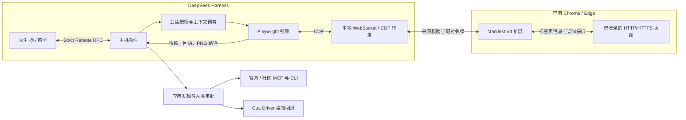

# dsh-doyourweb

本地 HTML：在 Chrome / Edge 扩展详情中开启“允许访问文件网址”，重新加载扩展后，已打开的 `file://` 页面会出现在 `@` 菜单，可读取、操作和批注。该开关由浏览器管理。

让 DeepSeek Harness 引用并操作你已经打开、保持登录的 Chrome 和 Edge 页面，用精简的页面上下文和批量操作减少重复读取。

`0.1.6` 改善桌面输入、快照句柄与连接界面，新增 `app_type` 打字和快捷键。支持页面元素批注和 `@` Windows 应用。批注先加入聊天草稿，可积累多条后按 Enter 发送；应用控制先查匹配的 MCP，已安装的本地 MCP 直接连接，缺少时询问安装；未发现 MCP 时使用 computer use。新提出的配置、远程端点和桌面驱动首次连接仍需确认，详见[批注与应用控制](docs/annotations-and-apps.md)。

[](https://github.com/SheepofSheep/dsh-doyourweb/actions/workflows/ci.yml)
[](LICENSE)
[](package.json)
[](package.json)

[English](README.md) | 简体中文

[在线体验说明](#local-demo) · [快速开始](#quick-start) · [使用文档](#usage)


*本地配对页面：将浏览器扩展连接到 DSH 插件，保留现有标签页和登录状态。*

> **本 fork**（[DeveloperYe/dsh-doyourweb](https://github.com/DeveloperYe/dsh-doyourweb)）新增远程浏览器支持，并收紧了本机管理面：另一台电脑上的 Chrome/Edge 也能接入。见 [docs/remote-browser.md](docs/remote-browser.md)。

---

## 01 · 项目介绍

网页任务常常依赖已经打开的页面和已经登录的账号。dsh-doyourweb 面向希望直接在 DeepSeek Harness 中处理这些页面的用户，不需要另开自动化浏览器，也不需要导出 Cookie。

项目由 DSH 插件和配套的 Manifest V3 浏览器扩展组成。插件接入原生 `@`、`/` 菜单，扩展提供标签页信息和控制通道。完成一次配对后，扩展会在后台重连，不必一直打开弹窗。

当前版本为 **0.1.7**，包和浏览器扩展版本一致，变更见[更新记录](CHANGELOG.md)。

## 02 · 功能预览

1. 在 DSH 输入 `/browser`，打开连接页面并查看扩展目录。
2. 在 Chrome 或 Edge 加载扩展，核对并批准四位配对码。
3. 用 `@` 或 `/` 选择已经打开的页面，再向 DSH 描述任务。

首屏截图展示的是配对界面，不是自动化任务录像。

<a id="local-demo"></a>

### 在线体验说明

项目没有公共在线演示。启用 DSH 插件后，默认本地连接页面为 [http://127.0.0.1:43187/setup](http://127.0.0.1:43187/setup)。浏览器控制通过这个本地桥接服务和已安装的扩展完成。

## 03 · 核心功能

| 功能 | 当前实现 |
| --- | --- |
| 复用已有页面 | 连接 Chrome、Edge 的普通 HTTP/HTTPS 和已授权的本地 file:// 标签页，保留登录状态。 |
| 原生页面引用 | 在 DSH 的 `@`、`/` 菜单中展示页面标题、站点和图标。 |
| 精简读取 | 使用可访问性快照，支持选择器、查询过滤和游标分页；初始引用上下文默认共用 2,400 字符预算。 |
| 批量操作 | 单次最多执行 12 个结构化动作，失败或发生导航时停止。 |
| 结果提取 | 按需返回 `text`、`value`、`href` 字段，每次提取最多 20 行。 |
| 简短回执 | `observe: "summary"` 跳过下一次页面快照；动作结果有 1,600 字符输出预算。 |
| 页面截图 | 将 PNG 保存到本地，返回文件路径，不把 base64 塞进文本上下文。 |
| 后台连接 | 保存配对配置、自动重连，并在空闲时释放调试连接。 |
| 元素批注 | 页面右上角“批注”选择元素，将说明、CSS 选择器、样式、位置和可选局部截图追加到聊天草稿；浮窗可拖动，多条批注一起发送。 |
| 应用引用 | `@` 搜索运行中的 Windows 窗口，显示程序图标，用进程启动时间和窗口句柄防止旧引用误控新进程。 |
| MCP / CLI | 默认查询匹配的 MCP；支持本机 stdio、Streamable HTTP、自定义连接器和有来源的配置提议。 |
| 安装确认 | DSH 原生提问或 `/apps` 本地页面批准安装；固定包版本，npm 禁用安装脚本，关闭重复询问仅限已审阅和信任的来源。 |
| 桌面回退 | 使用 Cua Driver MCP，默认只读有限控件树、按需截图；尽量显示所选窗口，也支持后台执行，反复读取无变化时停止。 |
| 键盘输入 | `app_type` 支持文本加 Enter、Tab、Esc 或组合键；可选 `expect` 一次读取校验结果。 |
| 鼠标操作 | `app_mouse` 支持点击、双击、右键、滚动和拖拽，一次画面读取最多执行 8 个已知目标动作；前台操作单独确认。 |

浏览器输出预算按 JavaScript 字符计算，包含 JSON 转义和元数据；应用工具的 `limit` 限制正文，状态、步骤和图片路径等元数据另计。MCP 不重复返回相同 JSON，CLI 的 stdout 与 stderr 共用正文预算。字符数不等于模型 token 数，输出预算也不限制 DOM 遍历耗时。

### WebMCP 优先控制（实验性）

`0.1.1` 会先检测页面提供的 WebMCP 工具。有适合任务的工具就调用，没有再读取普通页面快照。页面和工具注册未变化时，复用目录和参数校验器；成功调用后返回新的单次凭据，连续操作不用反复列工具。WebMCP 需要浏览器 API 和网站工具支持，普通网页仍使用 DOM 操作。浏览器要求、工具用法和本地测试见[实验说明](docs/webmcp-experiment.md)。

## 04 · 技术架构

| 层级 | 技术 |
| --- | --- |
| DSH 主机插件 | Node.js 22+、JavaScript ESM、Cordis 集成 |
| 原生客户端 UI | React、DSH UI primitives |
| 浏览器引擎 | Playwright Core 1.64.0、Chrome DevTools Protocol |
| 网站工具 | `document.modelContext`、Ajv 8.20.0 参数校验 |
| 本地桥接 | WebSocket（`ws`）、Zod 校验 |
| 浏览器扩展 | Manifest V3、`chrome.tabs`、`chrome.debugger` |
| 应用连接器 | 官方 MCP SDK 1.32.1、stdio / Streamable HTTP、无 shell 字符串的 CLI 参数调用 |
| 构建与检查 | esbuild、Node.js 测试运行器、GitHub Actions |



模型的浏览器工具只能访问用户在当前会话中引用的标签页。网页内容是不可信数据，不会作为用户指令或操作授权。

<a id="quick-start"></a>

## 05 · 快速开始

### 安装要求

- Node.js 22+ 和 npm。
- DeepSeek Harness；插件 API 已对照 `0.2.0-rc.2` 检查兼容性。
- 基于 Chromium 的 Chrome 或 Edge 125+，允许开启开发者模式并加载解压后的扩展。

### 安装 DSH 插件

通过 npm 安装时，在 DSH 打开 **插件 > 添加插件**，安装源选择 **npm 官方源**，输入：

```text
dsh-doyourweb
```

这种方式需要包已经发布。若官方源返回 `404`，可用下面的本地安装方式。新版本在镜像源中的同步可能有延迟。

### 构建并安装本地版本

```sh
git clone https://github.com/DeveloperYe/dsh-doyourweb.git
cd dsh-doyourweb
npm ci
npm run build
```

在 DSH 中打开 **插件 > 添加插件**，填入**构建完成后的项目目录绝对路径**。插件启用时会启动桥接服务，不需要另开开发服务器。

### 连接浏览器

1. 在 DSH 输入 `/browser`，打开本地连接页面。
2. 打开 `edge://extensions` 或 `chrome://extensions`，开启开发者模式，将项目中的 `extension/` 目录作为解压后的扩展加载。
3. 核对扩展徽标上的四位码与连接页面中的待配对请求，然后批准。
4. 回到 DSH，用 `@` 选择标签页并发送任务。

配对页面和扩展弹窗都可以关闭。安装 DSH 插件不会自动安装浏览器扩展。

升级 DSH 插件后，需要从托盘完全退出 DSH 再重新打开，确保加载新版本的主机模块。

### 配置

默认配置位于 [cordis.patch.yml](cordis.patch.yml)：

| 配置项 | 默认值 | 用途 |
| --- | --- | --- |
| `port` | `43187` | 本地桥接端口 |
| `snapshotChars` | `2400` | 页面读取和初始引用上下文的字符预算 |
| `idleTimeoutMs` | `120000` | 空闲多久后释放调试连接，单位毫秒 |

数据目录为 `<DSH_HOME>/browser-tabs/`；未设置 `DSH_HOME` 时使用 `~/.dsh/browser-tabs/`。插件显式配置的 `home` 优先。环境变量需要设置给 DSH 进程，插件不需要单独配置模型 API Key。

<a id="usage"></a>

### 使用文档

引用页面后，可以这样描述任务：

> 读取这个页面的结果列表，整理标题和链接，不要提交表单。

| 模型工具 | 用法 |
| --- | --- |
| `browser_read` | 默认 `mode: "auto"` 先检测 WebMCP，没有可用工具时返回 DOM 快照。工具不适合任务时用 `mode: "dom"`，可按 `selector`、`query`、`depth` 缩小范围；`cursor` 对 DOM 内容分页，`limit` 范围为 400～8,000 字符。 |
| `browser_act` | 使用最新快照 ID，执行点击、填入、按键、选择、勾选、悬停、滚动、导航、前进后退、等待或提取。 |
| `browser_capture` | 需要检查画面时，将截图保存到本地。 |
| `browser_webmcp_list` | 发现页面工具，或通过 `query` 缩小工具目录；目录有效时可直接复用。 |
| `browser_webmcp_call` | 用 `catalog`、`name`、`arguments` 调用匹配的页面工具，成功后返回 `nextCatalog` 供下一次调用。 |

同时授权了多个标签页时，工具调用需要通过 `tab` 指定已引用的页面。

### 批注与应用控制

安装或升级插件后，从托盘完全退出、重启 DSH，并重新加载浏览器扩展。本地开发时，先构建项目，再在 DSH 安装项目的绝对路径。不要同时启用 npm 版和本地版，以免占用同一端口。

- **批注**：打开扩展弹窗，点“批注当前页面”，或者引用页面后让 DSH 开启批注。点选元素、填写说明，按 Enter 或点“加入聊天草稿”，说明和局部截图会追加到工具条所示会话的输入框。可拖动浮窗、连续添加多条批注，回到聊天后按 Enter 一起发送；Shift+Enter 换行。不再保存独立批注文件或维护批注库。受控页面右上角也会显示批注按钮。
- **应用**：输入 `@Unity` 或其他运行中的程序名，选中窗口后描述任务。AI 先用 `app_discover` 查连接器，再用 `app_connect` 请求连接或安装，最后通过 `app_call` 调用。目录未收录的连接器可凭官方文档或仓库提出配置，同样需要你确认。
- **管理**：输入 `/apps` 打开本地“应用管理”，批准请求、配置连接器和安装策略，不用一直开着。`@` 中的文件、文件夹和对话分别显示 3 条预览，可展开或收起；单个文件夹仍可进入目录。
- **回退**：结构化接口不适合当前任务时才调用 `app_desktop`。默认读取有限控件树、不截图；需要画面时才传 `screenshot: true`，再用 `app_mouse` 批量点击、滚动或拖拽，最多 8 步，中间不自动截图。MCP/CLI 不要求窗口打开；桌面读取会尝试启动所选程序，重新读取后才能操作。启动失败可交由 computer use 检查，反复读取无变化会返回 `stop: true`。使用 DSH computer-use 同源的 Cua Driver，不会绕过系统权限。

详见[安装策略、Unity 配置和已知限制](docs/annotations-and-apps.md)。

<details>
<summary>工具示例：读取页面，再提取简短的结果列表</summary>

仅有一个已授权标签页时，调用 `browser_read`：

```json
{
  "mode": "dom",
  "depth": 8,
  "limit": 2400
}
```

将返回的快照 ID 填入 `browser_act`，选择器需要替换为实际页面中的选择器：

```json
{
  "snapshot": "<latest snapshot ID>",
  "observe": "summary",
  "steps": [
    {
      "op": "extract",
      "selector": "a.result-title",
      "fields": ["text", "href"],
      "maxRows": 10
    }
  ]
}
```

这些是模型工具参数，不是终端命令。`summary` 不返回新快照，下次操作前需要重新读取。

</details>

## 06 · 项目结构与技术细节

```text
src/
  host.js            插件生命周期、工具和会话上下文
  client.js          原生 @ 和 / 菜单数据源
  client-entry.js    React UI 与图标
  bridge.js          配对、扩展连接和 CDP 转发
  engine.js          快照、操作、提取与截图
  annotations.js     隔离元素选取与批注直达会话
  apps/              应用枚举、发现、审批、安装和 MCP/CLI/桌面调用
  manage.js          本机应用与连接器管理页面
  webmcp.js          网站工具发现、路由、校验与调用
  grants.js          按会话管理标签页授权
  protocol.js        页面引用与 Remote RPC 描述
  output.js          序列化输出预算
  vendor/            适配后的 Playwright 浏览器模型
extension/           Manifest V3 扩展和弹窗
scripts/             构建、集成测试和兼容性检查
test/                单元测试与测试页面
docs/setup-page.png  配对页面截图
cordis.patch.yml     DSH 插件注册与默认配置
lib/                 生成的构建产物，不提交到 Git
```

**快照与操作。** 完整快照文本缓存在本地，供游标分页使用。元素引用需要有效快照；读取、操作和导航都可能让旧引用失效。同一标签页上的调用按顺序执行。取消操作会报告已完成或状态不确定的步骤，不承诺撤销已经发生的操作。

**连接生命周期。** 空闲时释放调试连接，但不关闭标签页；再次读取时重新连接。浏览器重启会更新页面引用所属的会话，需要重新用 `@` 选择页面。

**数据处理。** 配对凭据和授权记录保存在本地数据目录，截图保存在其中的 `captures/`。已引用页面的片段会进入 DSH 模型上下文，可能发送给你配置的模型服务。不要公开配对文件和私人截图。购买、删除和敏感提交需要用户明确授权；插件没有独立的交易确认弹窗。

<details>
<summary>开发检查命令</summary>

```sh
npm run build
npm test
npx playwright-core install chromium
npm run test:browser
npm run verify:dsh -- --asar "<path to DeepSeek Harness app.asar>"
```

CI 配置了 Windows、Linux 单元测试，以及 Linux 上隔离的无头 Chromium 集成测试。徽章指向实际工作流状态，不是固定的“构建通过”图片。无头测试不替代日常浏览器配置与 DSH 原生界面的端到端验证。

</details>

## 07 · Roadmap / FAQ / License

### Roadmap

`0.1.3` 包含页面批注、应用引用和 MCP 优先的应用控制。后续重点是更多应用的实机兼容验证与连接器配置体验，暂未公布交付时间。问题反馈和功能讨论见 [Issues](https://github.com/SheepofSheep/dsh-doyourweb/issues)。

### FAQ

**每次都要打开扩展吗？** 不需要。配对一次后，扩展会在后台重连；更新扩展文件后需要重新加载。

**为什么有些页面不显示？** 只提供普通 HTTP/HTTPS 和已授权的本地 file:// 标签页，不包含浏览器内部页面和无痕页面。全部页面都不显示时，先检查扩展是否启用、是否完成配对。

**43187 端口被占用怎么办？** 不要让两份插件同时使用同一端口。停止重复的桥接服务，或修改插件的 `port` 配置，并让扩展重新连接到对应端口。

**目前有哪些限制？** 浏览器扩展通过加载解压目录安装，尚未上架扩展商店；不支持 Firefox 和 Safari。主机 API 已对照 DSH `0.2.0-rc.2` 检查，其他版本及原生界面流程仍需各自验证。

### 贡献与协议

欢迎提交 Issue 和 Pull Request。反馈时附上复现步骤、DSH 和浏览器版本；日志中请移除令牌、私人网页内容和账号数据。修改代码后，运行与改动相关的检查。

项目代码使用 [MIT 协议](LICENSE)。Playwright 衍生代码和 Lucide 图标保留各自协议，详见 [NOTICE](NOTICE)、[Apache-2.0](extension/APACHE-2.0.txt) 和 [ISC](extension/icons/LICENSE)。
