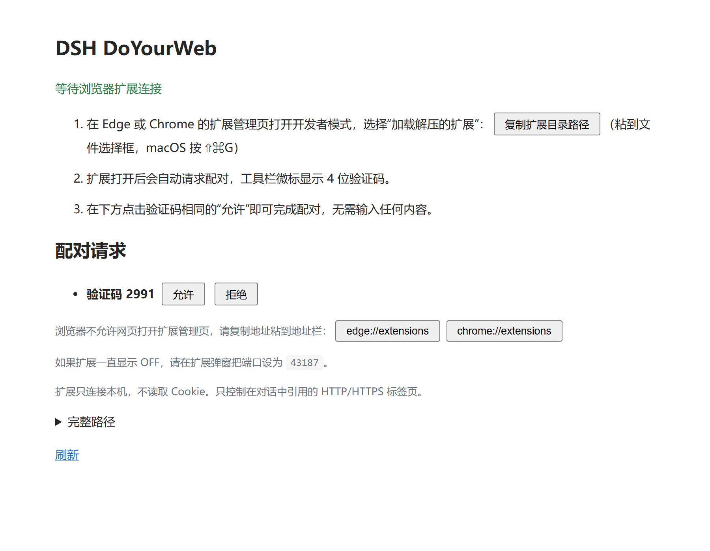

# dsh-doyourweb

[English](README.md) | [简体中文](README.zh-CN.md)

面向 DeepSeek Harness 的浏览器插件，用于引用并操控 Chrome、Edge 中已经打开的标签页，无需另开浏览器，也不需要导出登录 Cookie。

## 当前状态

开发时参考了 DSH `0.2.0-rc.2` 随附的插件 API。

- `ver0.1.0` 将包名从 `dsh-browser-tabs` 更名为 `dsh-doyourweb`，保留配对信息、端口、引用协议和 `browser-tabs/` 数据目录。升级后需重新选择一次标签页：引用现在绑定到本次浏览器运行，避免浏览器重启后复用的数字标签页 ID 继承旧授权。
- 修复操作取消、iframe 引用、配对超时和验证脚本误删目录。取消会传递给 Playwright，使旧快照失效，并保留已完成动作的回执。
- 批处理新增 `wait`、限定字段的 `extract` 和 `observe: "summary"`；多页面初始上下文共享一个输出预算，标题、URL 和 JSON 转义也计入限制。空闲后自动释放 debugger 及完整快照。

- 宿主模块和客户端模块已成功构建。
- 单元测试及隔离、无界面的 Chromium 扩展集成测试已通过。
- 已使用真实 DSH 客户端 Gateway 与 Typert 注册表模块验证 Remote 贡献项的挂载与调用，`@` 和 `/` 菜单可以访问宿主服务。
- 旧项目 `dsh-browser-tabs 0.1.3` 改为按验证码配对：本包的 `extension` 目录可直接加载（它自己固定了扩展 ID），扩展在工具栏徽标显示 4 位验证码，DSH 设置页面批准验证码相同的请求即可；令牌随后保存在扩展的浏览器存储中，不再生成任何文件。
- 旧项目 `dsh-browser-tabs 0.1.2` 修复了四个缺陷。其中三个导致两个菜单都显示 `服务不可用: Cannot read properties of undefined (reading 'list')`：
  - Remote 描述声明的是 `src-json` 编解码器，客户端 Gateway 会拒绝这类贡献项，`remote.browserTabs` 因此从未挂载；
  - 客户端以 `ctx.remote.browserTabs` 读取命名空间，却只注入了 `remote`；Cordis 在没有注入嵌套键时会拒绝该属性访问；
  - 每次启动时生成的扩展目录会短暂保留未配对的 `config.js` 模板，若 Service Worker 恰好在此时重启，就会导入空 token，表现为 DSH 正在运行但扩展显示 `OFF`。
  第四个缺陷会让浏览器控制在回合的第一步之后静默失效：`agent/pre-step` 每次只领取本步骤的输入批次，而后续步骤的批次里是工具结果、没有用户消息，按批次重建授权集合就撤销了引用。现在授权按对话累积，并记录在 `authorized.json`，DSH 重启后此前引用的标签页仍可控。
- 这些修复之后，与真实登录浏览器配置文件的连接**尚未在真实 DSH 会话中重新端到端验证**，不使用电脑控制调试。安装 DSH 插件本身不会自动安装浏览器扩展。

## 功能

- 在 `@` 和 `/` 菜单中列出已有 HTTP/HTTPS 标签页，与内置候选源并存。
- 从浏览器本地 favicon 缓存读取网站图标，缺失时显示地球图标。
- 通过 `/browser` 命令打开配套浏览器扩展的连接设置。
- 一键验证码配对：加载一次自带扩展、核对 4 位验证码即可，无需复制文件。
- 未连接时显示连接入口，不再静默隐藏浏览器候选项。
- 自动在后台连接、断线重连，不需要每次打开扩展弹窗。
- 提供精简的无障碍树快照，包含元素引用和明确的分页信息。
- 使用 Playwright 批量执行动作、条件等待和结构化提取，每次最多 12 步，支持 iframe 引用。
- 可只返回精简动作回执，空闲后自动释放调试器连接。
- 按需保存本地 PNG 截图。
- 将可操作标签页限定在当前对话的用户引用范围内，操作前拒绝过期快照。

## 环境要求

| 项目 | 要求 |
| --- | --- |
| DSH | `0.2.0-rc.2` 的插件 API。DSH 及其各包以 `@deepseek-ai/dsh*` 发布在 npm 上（MIT / BSD-3-Clause）。 |
| Node.js | `22` 或更新版本，以及 npm。 |
| 浏览器 | 基于 Chromium 的 Chrome、Edge `125` 或更新版本，并开启开发者模式。 |
| 平台 | 已在 Windows 验证。macOS、Linux 预期可用（路径来自 `os.homedir()` / `DSH_HOME`），但尚未测试。 |

## 构建与安装

```sh
npm ci
npm run build
```

在 DSH 中打开**插件 > 添加插件**，指向已完成构建的项目目录即可，位置随意（例如 `~/code/dsh-doyourweb`）。

本包声明了 `dsh.bundle`，并通过 `cordis.patch.yml` 提供 `dsh-doyourweb` 插件配置，保留 `browser-tabs` 实例 ID 以兼容迁移。不要直接安装尚未构建的源码目录，运行时入口为 `lib/host.js` 和 `lib/client.js`。

生成包含编译产物的分发包：

```sh
npm pack
```

`prepack` 会自动执行构建。生成的 `dsh-doyourweb-0.1.0.tgz` 包含运行时模块、扩展模板、组合包配置及文档，可通过 DSH CLI 安装：

```sh
dsh plugin --profile desktop add ./dsh-doyourweb-0.1.0.tgz
```

如果需要通过界面填写目录安装分发包，先解压归档，再选择其中的 `package` 目录。从 Git 克隆源码安装必须先执行上面的构建步骤，没有免构建的源码安装方式。

## 连接浏览器



配套扩展直接从本包（通过 DSH 插件管理器安装时在包内）的 `extension` 目录加载。它自己在 manifest 里固定了 `key`，因此在任何机器上扩展 ID 都一致，加载前不需要生成、复制或修改任何文件。这个 `key` 是**公钥**、不是密钥：它只用于固定扩展 ID，桥接服务据此校验 WebSocket Origin。请勿更换它，否则所有已加载的副本都会变成另一个扩展。

1. 在 DSH 中选择 `/browser`：页面提供「复制扩展目录路径」按钮，并列出待处理的配对请求。
2. 在日常使用的浏览器中打开 `edge://extensions` 或 `chrome://extensions`，启用开发者模式，选择“加载解压缩的扩展”，把复制到的路径粘贴进文件选择框（macOS 按 ⇧⌘G）。浏览器禁止网页打开扩展管理页，所以这一次粘贴无法省掉；页面同时提供 `edge://extensions`、`chrome://extensions` 的复制按钮，可粘贴到地址栏。
3. 扩展随即向 DSH 发起配对：工具栏徽标显示一个 4 位验证码。
4. 在 DSH 设置页面点击验证码相同的那个「允许」。这一步的核对就是对当前浏览器配置的授权；无需输入任何内容，令牌只在两个进程之间传递。
5. 返回 DSH，输入 `@`，选择标签页并说明任务。

配对完成后，令牌保存在扩展自己的浏览器存储里，之后每次启动直接复用，因此每个浏览器配置只需配对一次。弹窗显示连接状态，并提供「解除配对」和端口设置：DSH 默认端口是 `43187`，只有修改过插件 `port` 设置时才需要在弹窗里填同样的值（设置页面会显示当前端口）。

这是标准的 Manifest V3 浏览器扩展，每个浏览器配置文件只需加载一次。之后保持扩展启用，并让 DSH 与浏览器运行即可，不需要一直打开弹窗或设置页面。DSH 后启动或重启时，扩展会自动重连。在弹窗中选择的暂停状态会保存，浏览器重启后仍保持暂停。

更新包之后，到浏览器扩展管理页点击该扩展的“重新加载”。不要删除扩展或清空它的存储，以保留配对信息和配置文件身份。工具栏显示 `OFF` 表示正在等待 DSH。浏览器内部页面和隐身页面不在列表中，每次菜单查询最多返回 50 个匹配标签页。

目前通过加载解压扩展分发，尚未上架 Chrome 应用商店或 Edge 加载项商店。商店发布需要开发者账号和审核，与 DSH 插件管理器中的安装是两件事。

插件运行时，默认设置页面地址为 `http://127.0.0.1:43187/setup`。

### 从旧项目 dsh-browser-tabs 0.1.2 及更早版本更新

旧项目 `dsh-browser-tabs 0.1.3` 之前会为每次安装生成一份扩展副本，把配对令牌写进副本的 `config.js`，用户加载的是那份副本。桥接服务仍然接受这类副本及其旧令牌；但旧扩展没有浏览器运行标识，每次重连都需要重新选择标签页。要切换到新版，请加载本包的 `extension` 目录，在设置页面批准它发起的请求，再从浏览器扩展管理页移除旧的生成副本。之后可以删除遗留的 `browser-tabs/extension` 目录，桥接服务已不再读写它。

更新后重启 DSH（或禁用再启用插件），让重新构建的宿主与客户端模块生效，然后刷新浏览器中的 DSH 页面。

### 更新到 dsh-doyourweb

先在 DSH 中禁用并移除旧 `dsh-browser-tabs` 插件，再安装新版，避免两个插件同时占用 `43187`。保留 `browser-tabs/` 数据目录，新包会继续读取其中的配对令牌、授权记录和截图。GitHub 仓库地址暂时保留原地址，直到远程仓库本身更名。

浏览器扩展保留原公钥和扩展 ID。如果扩展目录未移动，点击“重新加载”即可；如果 DSH 把新版安装到另一目录，加载新版包的 `extension` 目录，不要先删除旧扩展或清空其存储。安装后刷新 DSH 页面，并用 `@` 重新选择所需标签页，以替换旧的配置文件级引用。

此后 DSH 重启、扩展后台重启均保留仍打开页面的引用；浏览器完全重启后生成新引用，需要再次选择标签页，但配对和网站登录状态不会丢失。

### 端口已被占用

旧项目 `dsh-browser-tabs 0.1.0` 存在卸载清理错误：禁用或移除插件后，桥接服务可能仍占用 `43187` 端口。旧项目 `0.1.1` 已改为由 Cordis 管理资源清理，正常卸载和启动失败都会关闭桥接服务。现在启动失败会给出明确指出端口的提示，而不是原始的 `EADDRINUSE`；扩展弹窗也可以把浏览器指向其他端口。

首次从旧项目 `dsh-browser-tabs 0.1.0` 更新时，先保存正在进行的工作，**彻底退出 DSH，包括后台或托盘进程**，再重新启动。只关闭窗口或重复安装插件，无法释放旧代码已遗留的监听。随后从同一项目目录安装或启用新版插件即可，不需要重置浏览器标签页、登录状态或扩展配对信息。

如果端口被其他程序或第二个 DSH 实例占用，请停止对应实例，或修改插件的 `port` 设置并在扩展弹窗里填相同的值。插件不会结束其他程序的进程，也不会静默更改浏览器连接端口。

## 配置

默认配置由 `cordis.patch.yml` 提供，宿主还接受可选的 `home` 设置。

| 设置 | 默认值 | 含义 |
| --- | --- | --- |
| `port` | `43187` | 本地桥接端口，仅监听 `127.0.0.1`。 |
| `snapshotChars` | `2400` | 单次读取和整段多页面初始上下文的序列化字符预算，范围 400-8000。 |
| `idleTimeoutMs` | `120000` | 空闲达到该毫秒数后释放 debugger 和完整快照，不关闭标签页。 |
| `home` | `DSH_HOME` 或 `~/.dsh` | 数据基础目录，插件数据保存在其下的 `browser-tabs/` 中。 |

`browser-tabs/` 下的数据包括：`pairing.json`（连接令牌，切勿提交或分享）、`authorized.json`（各对话中用户用 `@` 引用过的标签页标识，不含页面内容）、`captures/`（按需保存的截图）。删除 `pairing.json` 会轮换令牌，需要重新配对扩展；删除 `authorized.json` 只会导致此前引用的标签页需要重新用 `@` 选择。`0.1.3` 不再生成任何扩展目录。

修改端口后，请在扩展弹窗里设置相同端口（设置页面会显示当前端口），不要让两个插件实例占用同一个端口。

## 模型工具

| 工具 | 用途 |
| --- | --- |
| `browser_read` | 读取精简快照；用 `selector` 或 `query` 缩小范围，或用 `cursor` 继续读取。 |
| `browser_act` | 使用最新快照 ID 执行动作、条件等待和限定字段提取；`observe: "summary"` 可跳过新快照。 |
| `browser_capture` | 保存截图并返回本地路径，不在文本输出中放入 base64。 |

动作可以使用快照中的元素引用，例如 `e1`、`f2e7`，也可以使用 Playwright 选择器。批量动作遇到首次失败或页面导航时会停止，并报告已完成的步骤。继续前先读取当前状态，不要重复执行已完成的动作。

取消操作也会使旧快照失效；下一次读取通过 `lastAction` 返回取消回执。出现 `uncertainStep` / `mayHaveLateEffects` 时，说明取消时正在执行的动作可能已经生效，需要检查页面，不能直接重试。

可以把“填写、点击、等待结果、提取内容”放进同一次 `browser_act`：

```json
{
  "snapshot": "<最近一次读取返回的快照 ID>",
  "observe": "summary",
  "steps": [
    { "op": "fill", "ref": "e2", "value": "example" },
    { "op": "click", "ref": "e3" },
    { "op": "wait", "selector": "#result", "state": "visible", "timeout": 2000 },
    { "op": "extract", "selector": "#result a", "fields": ["text", "href"], "maxRows": 10 }
  ]
}
```

`wait` 支持 visible、hidden、attached、detached 状态，最多等待 8000 毫秒。`extract` 只允许 text、value、href 字段，最多 20 行、每字段 200 字符，还会根据共享动作输出预算进一步缩减，密码输入框的值不提取。结果通过 `omittedRows` 和 `truncated` 标明省略情况，不提供任意 JavaScript 执行器。精简模式不返回新快照 ID，下一批操作前需要重新读取；页面导航仍立即结束当前批次。

## 效率与隐私

标签页发现只向界面返回元数据，不会把所有已打开页面的内容发给模型；缓存的网站图标也只用于界面，不进入模型上下文。用户引用页面时，最多 4 页共享 `snapshotChars`（默认 2400 字符）的初始上下文预算，包括包装文本和元数据；额外页面以 `omittedTabs` 提示，可再明确读取。

单次读取的 400-8000 字符限制覆盖完整 JSON 转义后的响应，而不只是正文；过长的标题和 URL 会以 `metadataTruncated` 标记，正文游标分页仍可无损继续。动作输出限制为 1600 字符，优先保留动作回执。这些是字符预算，不等同于已经测量的模型 token 数。

完整快照只保存在本地，直到连接释放。输出限制不能保证 DOM 遍历耗时也受限，需要通过 `selector`、`query` 和深度（默认 8）缩小读取范围。`summary` 模式会完全跳过动作后的快照采集，进一步减少耗时和输出。

桥接服务仅监听 `127.0.0.1`，只接受固定扩展 ID 的 WebSocket Origin，并要求每次安装生成的令牌。由于本机进程可以伪造 Origin，首次连接改由人核对：扩展在徽标上显示 4 位验证码，DSH 设置页面批准验证码相同的请求。桥接服务按需附加到被引用标签页的调试器，并在连接停止或空闲后释放控制。再次读取会重新连接，空闲前的快照游标已失效。不包含隐身标签页和浏览器内部页面。打开 DevTools 或其他调试器可能中断控制。

这些工具返回的页面数据会进入 DSH 所配置模型的上下文。只引用你愿意向该模型提供内容的页面。浏览器内容属于不可信数据，不是指令或授权。破坏性操作、购买和敏感信息提交仍需要用户明确授权；工具描述本身不构成逐项交易审批机制。

不要提交或分发 `pairing.json`，它包含本地连接令牌。包内的 `extension/config.js` 只带默认端口，可以安全发布并直接加载。

## 开发与测试

```sh
npm test
npm run build
```

CI 会在 Linux 和 Windows 上运行这套单测，并在 Linux 上跑浏览器集成测试，见 `.github/workflows/ci.yml`。

运行浏览器集成测试前，需要先安装与 Playwright 匹配的测试浏览器：

```sh
npx playwright-core install chromium
npm run test:browser
```

集成测试使用一次性浏览器配置文件、本地测试页面和桥接端口 `43188`，验证扩展标签页列表、经过认证的 CDP 传输、批量填写、点击、等待及提取、精简回执、经过引擎的 iframe 引用操作、导航后的过期快照、进行中的操作取消、截图，以及空闲释放和重新连接后标签页仍保持打开。

测试还覆盖本地网站图标、DSH 后启动时的后台连接、DSH 和浏览器重启后无需弹窗的自动重连，以及浏览器完全重启后的授权隔离。测试不会操作用户的真实浏览器配置文件，也不能证明 DSH 原生菜单界面已通过验证。

单元测试固定了 DSH 契约与配对规则：Remote 描述必须使用 strict 编解码器（客户端 Gateway 会拒绝 `src-json`），客户端必须在不注入自身所挂载的嵌套键的情况下解析命名空间，桥接服务绝不能写入用户加载的扩展目录，令牌只会交给验证码经用户批准的那个请求（伪造、过期或被拒绝的请求都拿不到），且用户引用的标签页在后续步骤及重新激活后仍保持授权。生命周期与授权检查在一次性子进程中驱动真实的 `agent/pre-step` 瀑布；扩展后台则运行在桩 `chrome` 环境里，断言徽标验证码、令牌落盘与端口字段。

插件依赖三个 DSH 并未在文档中冻结的接口：生成的 `strict` Remote 编解码器、Typert 注册表和客户端 API Gateway。DSH 升级后可以这样复检（DSH 的运行时打包在应用资源里的 ASAR 归档中）：

```sh
npm run verify:dsh -- --asar "<app.asar 路径>"
```

脚本会把相关包解出到 `.local/dsh-extract`（Git 忽略），然后断言：真实注册表接受本包的宿主贡献项、真实 Gateway 能挂载并调用其客户端贡献项、构建产物 `lib/client.js` 能通过 `@` 候选源列出宿主标签页。运行前需要先 `npm ci`，以便解出的包能解析 Cordis。`--out` 必须指定专用目录；脚本只覆盖自己的两个解出文件，不再递归删除输出目录。

工具栏 PNG 图标已包含在源码包中。需要使用匹配的测试浏览器，从随附的 Lucide 图形重新生成图标时，可运行 `npm run icons`；README 里的设置页截图由真实页面生成，可运行 `npm run screenshot` 重新生成。

宿主生命周期测试使用与 DSH `0.2.0-rc.2` 相同的 Cordis `4.0.4`，在一次性子进程中验证反复启停和启动失败后的清理，不操作正在运行的 DSH 实例。

## 项目结构

```text
src/                  DSH 宿主、客户端、桥接服务、授权记录和浏览器引擎
src/vendor/           改编自 Playwright 的 CDP 标签页模型
extension/            配套扩展（可直接加载，自带固定扩展 ID）
scripts/              构建、浏览器集成测试和 DSH 契约复检脚本
test/                 Node.js 单元测试
cordis.patch.yml      DSH 组合包配置
lib/                  生成的运行时入口，Git 忽略此目录
```

## 许可证

项目代码采用 MIT 许可证。改编自 Playwright 的标签页模型采用 Apache-2.0，版权声明与许可证条款见 `NOTICE` 和 `extension/APACHE-2.0.txt`。
工具栏地球图形来自采用 ISC 许可证的 Lucide，详见 `extension/icons/LICENSE`。
