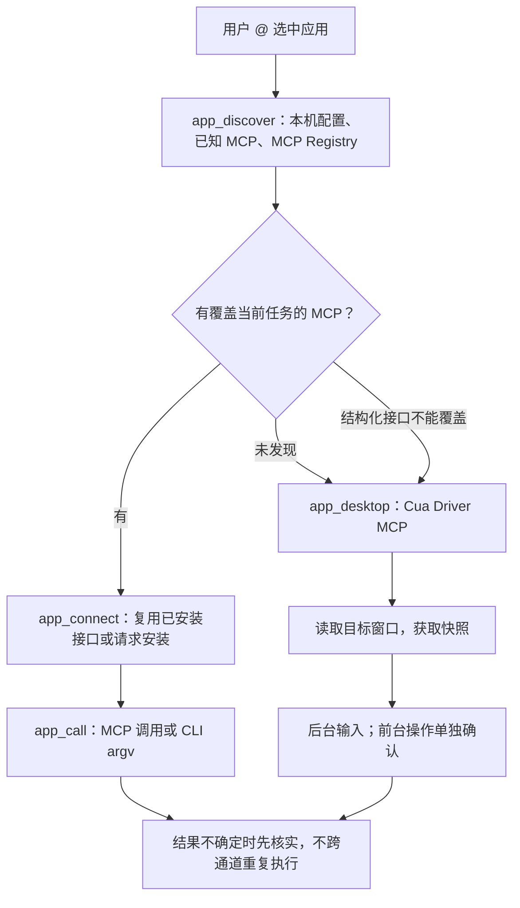

# 页面批注与应用控制

本地 HTML：在 Chrome / Edge 扩展详情中开启“允许访问文件网址”，重新加载扩展后，已打开的 `file://` 页面会出现在 `@` 菜单，可读取、操作和批注。该开关由浏览器管理。

本指南对应 `0.1.3`。浏览器控制支持 Chrome / Edge，运行程序的 `@` 枚举目前只支持 Windows。

## 本地试用

日常使用可在 DSH 的“插件 → 添加插件”中选择 npm 官方源，安装 `dsh-doyourweb`。需要本地开发时，按以下步骤操作：

1. 在项目中执行 `npm ci`、`npm run build`。
2. 在 DSH 的“插件 → 添加插件”填入当前项目绝对路径。旧版插件与本地版不能同时使用同一端口。
3. 从托盘完全退出 DSH 后重启，在浏览器扩展管理页重新加载 `extension/`。
4. 浏览器控制继续使用 `/browser`；新增的 `/apps` 打开本机应用、连接器和安装确认管理页。默认地址为 `http://127.0.0.1:43187/manage`，端口跟随插件配置。

插件本身不需要额外开发服务器，也不需要单独的模型 API Key。浏览器扩展只负责页面控制；运行程序的枚举、连接器和安装由 DSH 主机插件处理。

## 页面批注

先在 DSH 打开目标会话，再打开扩展弹窗，点“批注当前页面”。已经被 DSH 控制的页面右上角也会出现“批注”按钮。选择元素、填写说明，可勾选局部截图，按 Enter 或点“加入聊天草稿”。每条批注会追加到目标会话的输入框，可积累多条，保留原有文字、引用和附件；回到聊天按 Enter 一起发送。Shift+Enter 换行。拖动工具条标题可移动浮窗，窗口缩小时会保持在可见范围内。

工具条会显示发送目标的会话标题。重新开始选取时会重新确认当前会话；如果多个 DSH 窗口打开了不同会话，请从目标会话调用 `browser_annotate` 明确指定，不猜测发送位置。

批注包含页面地址、标题、CSS 选择器、标签、可见文本摘要、部分计算样式、位置和你的说明。不会主动读取输入框值。批注输入控件与页面脚本隔离，评论和元数据中的应用、标签页引用不会增加控制权限。选中元素时拦截常见指针与点击事件，但页面先前注册的捕获监听器仍可能先运行，不应在高风险操作界面测试选取。

批注是调试线索，不是实时 DOM，也不会自动把元素映射到源码。页面导航、重新渲染后应重新核实。当前选择器不支持深入跨域 iframe；Shadow DOM 元素会标记 `shadow`，选择器不保证能从文档根直接定位。插件不单独保存批注或截图；发送后的消息和图片由 DSH 按普通会话及附件处理，仍可能含隐私信息。截图需要当前模型支持图片；发送失败时会提示错误并保留填写内容。

空闲释放或插件退出会移除工具条，避免断开后的保存按钮挂起。未保存的评论草稿只暂存在原页面内；重新从扩展开启后可继续填写，需要重新选择元素。显式关闭工具条会清除草稿。

## `@` 应用与路由

`@` 菜单中的文件、文件夹和对话默认每组显示 3 条，点“展开文件 / 展开文件夹 / 展开对话”查看全部，点“收起”返回；输入关键词时不折叠搜索结果。展开文件夹分组后，单个文件夹仍能按 DSH 原有方式进入目录或插入引用。

文件和文件夹分组优先于浏览器、应用列表显示。也可直接输入 `@文件`、`@文件夹`、`@对话`（不必加冒号）打开对应分组；搜索具体名字可用 `@文件:readme`，普通文件名与引号路径仍沿用 DSH 原生搜索。

DSH 本地来源默认只返回 20 个候选，且目录排在文件前。目录占满上限时，插件会从同一个工作目录补回文件候选，最多占用一半名额，不扩大总上限、不递归扫描，也不读取文件内容。默认不补隐藏文件。没有文件候选时，`@` 主列表仍显示“搜索文件”，可输入名称搜索子目录，文件分组不再直接消失。

应用列表显示有真实可见顶层窗口、路径对应 `.exe` 的 Windows 程序。没有启动的程序不显示。窗口列表过滤托盘、输入法、系统壳和后台辅助窗口。最小化的正常应用保留，同一个程序打开的多个窗口分别列出，前台窗口优先；名称和窗口标题都会参与搜索，也支持 `Unity.exe` 这样的查询。`@` 菜单从本机可执行文件批量读取程序图标，并按路径缓存；读取失败时显示通用应用图标。图标不进入模型上下文。选择目标后发送任务，例如：

> @Unity 检查当前项目有哪些场景。先查匹配 MCP；已安装就连接，未安装先询问安装，没有匹配 MCP 就使用 computer use。



默认路由是匹配 MCP → computer use，不再为普通应用操作额外搜索 CLI。原有手动配置的 CLI 仍可调用。窗口会尽量恢复并显示；系统不允许抢占焦点时仍可后台执行。桌面读取传 `foreground:false` 可保持后台。

发现会检查本机配置、已知 MCP 和公共 MCP Registry；网络错误会返回诊断。没有结果表示本次未发现匹配 MCP，此时直接使用 computer use。

发现结果提供来源链接和进一步搜索入口。模型也可以通过 `app_connect.configuration` 提出目录外连接器：必须附文档、发布者和明确命令、URL 或固定版本的 npm/PyPI 包。它始终按未核实的社区配置处理，不能自称官方或跳过审批。也可以直接在管理页配置本机已安装工具。

Registry 和 npm 只是发现来源，不保证包安全，也不证明连接器属于应用官方。内置来源标记与自定义配置分开处理。

## 安装与授权

已安装、无需补充配置的本地 MCP 直接连接；安装、新提出的配置、远程端点与桌面驱动访问需要批准。支持 DSH 原生 `userQuestions` 提问；当前界面没有该服务时返回待批准请求，由你在 `/apps` 的“连接请求”中处理。模型工具没有批准参数，网页文字也不能提供批准。

支持的安装方式：

| 来源 | 实现与限制 |
| --- | --- |
| npm | 校验精确包版本和可执行入口，在插件专属目录安装，设置 `--ignore-scripts`。依赖安装脚本的包可能无法运行，需要你另行审阅处理。 |
| PyPI | 需要本机已安装 `uv`，在专属工具目录安装固定版本。包安装和构建本身可能执行第三方代码，仍需先审批。 |
| Unity CLI | 使用 Windows `winget` 的精确包 ID `Unity.CLI`。若需要接受许可、提权或刷新 PATH，提示你处理，不静默代答。 |
| Cua Driver | 使用上游固定 `0.28.0` release 的 Windows 对应架构二进制，校验 GitHub 发布的 SHA-256，再解压运行。没有可校验资源时拒绝安装。 |

“下载与安装前询问”默认开启。关闭后，只有**此前已批准、配置未改变且发布者在信任名单中**的连接器可以免重复询问安装。新提出的来源、远程端点、桌面连接、前台输入、OS 权限和软件许可不会自动获准。管理页可撤销连接器，关闭其当前连接并清除记住的批准。

MCP 支持 stdio 和 Streamable HTTP。非本机远程接口要求 HTTPS；本机回环地址可使用 HTTP。远程 OAuth 登录流程暂未实现，需要按服务要求在本机配置凭据。不要将 API Key、密码或令牌发到聊天里。

发现卡片的“配置”按钮会打开候选模板；必填参数或凭据缺失时也会进入配置页。修改 `args`、`env`、`headers` 等并保存。遇到 `requiresConfiguration: true`，完成文档要求的参数后将其改为 `false`。同 ID 的配置变化会撤销旧连接，并取消尚在安装或握手的旧连接请求，需要重新审批。凭据保存在本机 `applications.json`，管理列表不回显它们；编辑器模板中的空值需要自行填写，保存时请留意是否要覆盖已有值。

应用引用包含插件运行期 ID、进程启动时间、PID 和窗口句柄。MCP/CLI 在窗口关闭后仍可使用该引用；桌面读取可按同一可执行路径重新绑定唯一窗口，或启动一次程序并等候窗口出现。多个候选窗口需要重新选择，DSH 重启后引用失效。这只限制本插件的路由目标，**不是第三方 MCP/CLI 的操作系统沙箱**；连接器本身仍可能具有文件、网络或其他程序访问权。

## Unity 注意事项

[Unity 官方文档](https://docs.unity.com/en-us/unity-cli/use-unity-cli)提供 CLI 和 `unity mcp`；[迁移说明](https://docs.unity.com/en-us/unity-cli/replace-mcp-server-unity-cli)说明了旧方案与 CLI 的关系。控制编辑器还需要符合版本要求的 Unity 和项目内的 Unity Pipeline 包。安装 CLI 不等于完成项目接入，本插件不会擅自修改 Unity 项目、登录账号或接受许可。

## 桌面回退

`app_desktop` 使用 [Cua Driver](https://github.com/trycua/cua/tree/cua-driver-rs-v0.28.0/libs/cua-driver)，与 [DSH 实验性 computer-use](https://github.com/deepseek-ai/deepseek-harness/blob/master/docs/subsystems/computer-use.md)的上游一致；不是直接调用 Codex 内部工具，也不是假定 DSH 默认已有桌面能力。

默认只读控件树，不请求截图；默认最多遍历 150 个节点、8 层，支持用 `arguments.query` 缩小范围。只有需要根据画面定位时才传 `screenshot: true`；画布类应用可同时传 `arguments.include_accessibility_tree: false`，跳过控件树遍历。短时间重复读取会复用结果；没有动作却持续读取同一状态时返回 `no_progress` 和 `stop: true`，不继续截图轮询。界面确实变化后才使用 `refresh: true`，不要用它绕过停止提示。

`app_mouse` 支持点击、双击、右键、滚轮和按下—拖动—释放，坐标取自目标窗口截图，不是整块屏幕坐标。一次最多执行 8 个已知目标动作，不在每一步后截图；如果下一步目标要等菜单或布局变化后才能确定，应在此处分批。默认后台操作；不支持后台输入时不会自动切前台，`foreground: true` 需为整组操作单独确认。

动作需要最近 90 秒内针对这个引用和会话的快照；一个快照用于一次输入或一组输入，之后失效。像素操作必须使用带图片的快照。所有步骤会先校验参数，再开始执行；中途失败会停止并返回已完成步数，不重放已完成或可能已执行的操作。操作后只返回回执，需要确认结果或定位新目标时再读取一次，任务完成就停止。

`app_call.limit` 限制 CLI 的 stdout、stderr 合计正文，MCP 的文本与结构化正文共用预算，相同 JSON 只返回一份。桌面批处理按整批 `limit` 均分正文预算，预算用尽后不再输出空文本块。状态、步骤及图片路径等元数据另计；字符预算不等于模型实际计费 token 数。

窗口列表缓存 2.5 秒，并发枚举合并为一次；真正发送输入前仍重新校验窗口及进程身份。MCP/CLI 调用不依赖窗口存活。桌面读取会恢复同路径的唯一窗口，或后台发起一次启动并有限等待；启动失败时返回具体诊断，可用 computer use 检查启动过程，不反复要求手动开窗。新窗口必须重新读取，旧快照不能用于输入。菜单只枚举运行中的窗口，不再扫描已安装程序目录。默认发现只查 MCP，不额外查询 npm CLI。默认控件读取超时 8 秒，整组输入超时 15 秒，可用 `timeout` 调整到最多 30 秒。

<details>
<summary>模型工具参数示例：读取一次画面，再点击并拖拽</summary>

先调用 `app_desktop`，将 `app` 替换为用户真实选中的引用：

```json
{ "app": "<用户选中的应用引用>", "screenshot": true, "arguments": { "include_accessibility_tree": false } }
```

查看返回图片，确认坐标后调用 `app_mouse`；以下坐标只是参数示例：

```json
{
  "app": "<同一个应用引用>",
  "snapshot": "<上一步返回的快照 ID>",
  "steps": [
    { "action": "click", "x": 120, "y": 80 },
    { "action": "drag", "x": 200, "y": 200, "toX": 400, "toY": 300, "durationMs": 600 }
  ]
}
```

`app_type` 可在一次调用中填入文本并按 Enter。下面的控件名称需要来自刚读取的窗口；Steam 的树为空时应改用截图中的真实坐标：

```json
{
  "app": "<用户选中的应用引用>",
  "snapshot": "<app_desktop 返回的 snapshot UUID>",
  "element": { "role": "ComboBox", "name": "搜索商店" },
  "text": "Isaac",
  "keys": ["Enter"]
}
```

默认 `mode: "auto"` 有控件目标时使用 UIA，否则使用按键输入。`mode: "value"` 要求 UIA 控件目标并替换其值；`mode: "keys"` 使用已聚焦字段或截图中的 `x,y`，不要同时传 UIA 控件句柄。单键用 `keys: ["Tab"]`、`["Esc"]`，组合键用 `["ctrl", "a"]`。后台不可用时会明确拒绝，不自动换通道重复输入。部分批次已输入文字、但 Enter 失败时，只能检查后继续尚未完成的步骤。

`app_desktop`、`app_mouse`、`app_type` 均可附带 `expect: {"role":"ComboBox","name":"搜索商店","value":"Isaac"}`，执行后读取一次并检查准确匹配，返回新快照和控件。它不轮询、不重放动作，读到字段值也不代表搜索结果已加载。

`app_desktop` 的辅助操作：

- `tool: "capabilities"` 返回允许的动作及参数；`key`、`type` 分别兼容 `press_key`、`type_text`，也允许驱动提供的 `set_value`。
- `tool: "controls"` 配合原 `snapshot` 和 `arguments: {"offset": 20}`，读取已有控件的下一页，不重新遍历 UIA。下一页偏移量取自 `next_offset`。
- `tool: "focus_window"` 恢复并显示所选窗口，再读取状态；附加 `screenshot: true` 可取得恢复后的画面。不切换到另一个应用或同进程的其他顶层窗口。

`snapshot` 是插件用于会话和窗口校验的 UUID，`snapshot_id` 是驱动返回的 `s0000000d` 一类句柄，两者不能推导。使用 `element_index` 时插件自动补充匹配的驱动句柄；也可直接用 `element_token`，或 `element: {"role":"Button","name":"搜索"}` 做唯一、准确匹配。分页和缓存读取不使令牌失效；驱动产生新快照后，旧令牌仍会失效。

最小化窗口可能返回 `(-32000,-32000)`。插件检查 DWM 边界及底层输入矩形，遇到伪坐标会在投递前拒绝；先恢复并读取窗口，再操作。坐标诊断中的屏幕点是按截图尺寸估算，实际投递仍由驱动完成。窗口调整大小后需重新截图。

CEF/SDL、Electron、Qt 等程序的后台输入支持各不相同。首步明确拒绝且未投递时保留快照，不设置未知副作用锁；超时、部分执行或其他未知错误仍需读取状态。CEF 空树时会给出截图路径和应用支持的 `--force-renderer-accessibility` 提示，不自动重启程序、修改启动参数或开启 CDP 端口。Steam 的商店个性化过滤也不会被插件修改。

</details>

MCP、CLI 或桌面操作超时后，可能已经发生修改。插件记录不确定状态，禁止直接换通道重复修改；成功读取状态后才允许继续。这不是事务回滚，也不能保证识别所有外部副作用。

图像默认写入本机文件；若 DSH 有附件服务，会同时提交为图像工具结果。模型必须支持图像才能判断像素内容。无图像支持时，优先用可访问性信息或结构化接口；不要声称看到了截图。系统权限、安全桌面、受保护或提权窗口仍可能无法操作。

## 存储与验证范围

数据位于 `<DSH_HOME>/browser-tabs/`（或插件配置的 `home`）：应用配置 `applications/applications.json`、连接器安装 `applications/connectors/` 和应用截图 `applications/captures/`。批注不写入这里，也不再读取旧版 `annotations.json` 或提供独立批注列表；旧文件不会自动删除。批注消息及所附图片由 DSH 正常管理。不要上传凭据、私有截图或配置。

本次验证覆盖单元测试、真实 stdio MCP 握手、独立 Chromium 扩展/CDP、元素批注与截图、桌面/移动端管理页，以及已安装 DSH 的 Remote 契约。没有自动安装真实社区连接器，没有操作你的日常浏览器配置、Unity 工程或真实桌面。各应用的实际兼容性需要获得相应权限后验证。

## English

Version `0.1.3` supports installation from npm as `dsh-doyourweb`, or from a locally built project directory. Fully exit DSH from the system tray, restart it, and reload the Chrome/Edge extension after an upgrade. Do not run two plugin copies on the same port. `/apps` opens the local manager; `/browser` remains the pairing entry.

**Annotations:** open the target DSH conversation, then choose “批注当前页面” in the extension popup or “批注” on a controlled page. Pick an element, write a comment and press Enter or click “加入聊天草稿”. It appends to the target chat draft with an optional cropped image. Drag the toolbar and collect multiple annotations; press Enter in chat to send them together. Shift+Enter inserts a newline; no separate annotation files or `@` library are kept. DSH retains the normal message and attachment. Multiple distinct open DSH conversations require an explicit `browser_annotate` call from the destination conversation. Metadata includes URL, selector, selected computed styles, visible text and bounds, not input values. It is historical context, not a source-code mapping. Cross-origin frame selection and document-root Shadow DOM selectors are limited. Idle detach removes the toolbar and retains an unsent comment draft only in the original page. Image attachments require an image-capable model; delivery errors retain the comment.

**Apps:** `@` lists running Windows application windows with executable icons. Unopened installed apps are hidden. Tray, input-method, shell and helper windows are excluded. Minimized apps and multiple windows are retained, with the foreground window first; executable names such as `Unity.exe` are searchable. Files, folders and conversations each show three previews with expand/collapse controls; keyword searches and individual folder navigation remain unabridged. `app_discover` checks known official connectors, the public MCP Registry and npm CLI index. Choose a connector that actually covers the task, not merely one that exists. The sources are independent and cached; no result means “not discovered”, not “unsupported”. Source research can produce a proposed MCP/CLI configuration for `app_connect`, or a human can edit it locally. Proposed sources remain unverified/community.

**File visibility:** native reference groups appear before browser/app lists. Bare `@` retains a file-search entry even without current file candidates; `@文件`/`@files` opens the file category. If the local provider's directory-first limit excludes every file, the plugin backfills visible files from the same workspace root within the existing result budget. It does not read file contents, recursively scan, or supplement hidden files. Keyword/path queries and native reference insertion remain unchanged.

**Approval:** first connections and installations need a native DSH question or an explicit human action in the manager. There is no model approval flag. npm installs exact versions with lifecycle scripts disabled; PyPI needs `uv` and may run third-party build code. Unity uses `winget` package `Unity.CLI`. Cua Driver uses a fixed upstream release with SHA-256 verification. Missing runtime prerequisites, licenses, login and OS permissions remain human decisions.

Disabling installation prompts only bypasses repeat-install approval for an unchanged, previously reviewed connector whose publisher is in the local trust list. It does not approve new sources, desktop connections, foreground actions or OS elevation. Configuration changes close old connections, cancel pending installation/handshake requests and require fresh approval. The manager can revoke a connector. Credentials are stored locally and not echoed in lists; never paste secrets into chat. Remote OAuth is not implemented; configure supported server credentials locally.

**Desktop fallback:** `app_desktop` uses official Cua Driver MCP, the upstream used by DSH's experimental computer-use integration. It does not invoke Codex's private tools or assume a desktop provider exists. Default reads request a bounded control tree without images; `screenshot:true` opts into visual grounding, optionally with `arguments.include_accessibility_tree:false` for canvas work. `app_mouse` supports up to 8 known-target clicks, double/right clicks, scrolls or drags from one fresh visual snapshot. Coordinates are window-local image pixels. Batches validate before execution, stop at failure and report completed steps; no automatic screenshots follow inputs. Background input is the default; foreground input asks once per batch. Snapshots expire after 90 seconds and are consumed per input/batch. Short repeated reads are cached, unchanged polling returns `no_progress`, while desktop reads can reconnect a unique window at the selected executable path or launch that app once with a bounded wait. Launch failures include diagnostics for computer-use inspection; ambiguous windows require selection. Input requires a new snapshot after reopening. Window enumeration is cached/single-flight but identity is rechecked before dispatch. MCP/CLI discovery requests overlap. Defaults are 8 seconds per read and 15 seconds per input batch, adjustable via `timeout` up to 30 seconds. Uncertain effects block mutations until a successful inspection; never repeat an action through another channel. Images become local files and, where available, DSH image attachments. The model must support images for pixel inspection.

Background MCP/CLI connections keep working without a visible window. Desktop reads can rebind the selected executable, but snapshots are tied to the current process/window identity. References expire on plugin restart. This scopes routing, not the third-party connector's OS privileges: MCP servers and CLIs are not sandboxed to the selected application. Unity additionally requires compatible editor/project integration such as Unity Pipeline; installing its CLI alone does not configure the project.

Validation uses unit tests, a real stdio MCP fixture, disposable Chromium extension/CDP tests, responsive annotation/management screenshots and the installed DSH Remote contract. Real desktop applications, user browser profiles and third-party installations were not exercised. Browser support remains Chromium-based Chrome/Edge; app inventory is Windows-only.


Version 0.1.6 adds `app_type` (text plus Enter/Tab/Esc/chords), exact `element:{role,name}` lookup, and optional `expect` readback. `app_desktop` helpers `capabilities`, `controls` with `arguments.offset`, and `focus_window` expose supported parameters, page cached handles, and restore/read the exact selected window. Plugin `snapshot` UUIDs and driver `snapshot_id` handles are separate; paging does not refresh driver tokens. Structured control handles survive text truncation. DWM frame bounds plus native sentinel checks refuse minimized pixel input before dispatch; resize requires another visual snapshot. Known pre-input refusals do not create an uncertainty lock. The connection and annotation UI has been refreshed. Sparse CEF accessibility trees still require screenshots; background input and accessibility support depend on the application. No debugging port is opened or application restarted automatically.
