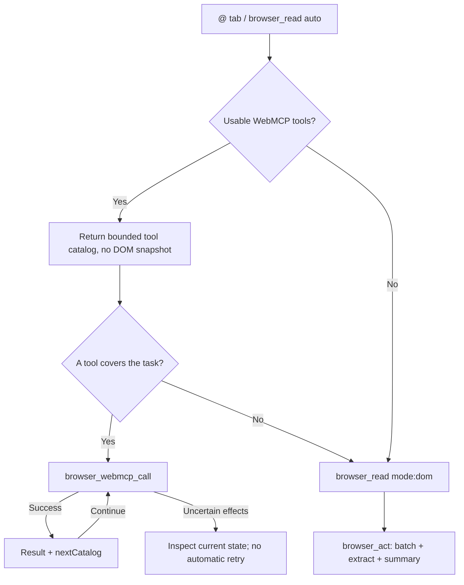

# WebMCP Experiment / WebMCP 实验

This experimental feature is included in `0.1.1` and was developed on branch `Trywebmcp`. It checks the selected page for tools through `document.modelContext.getTools()` before collecting a DOM snapshot, and calls matching tools through `executeTool()`. It does not inject website tools or use OpenAI's private runtime. Pages without usable site tools keep using the existing DOM tools.

本实验性功能从 `0.1.1` 开始提供，开发分支为 `Trywebmcp`。引用页面后，插件会先检测网站自己注册的 WebMCP 工具。有合适工具就调用工具，没有则使用原来的读取、点击和输入功能，沿用现有扩展和本地 CDP 通道。

## Try It / 试用

1. In DSH's plugin installer, select the official npm registry and install `dsh-doyourweb-remote@0.1.1` or a later version. Version `0.1.0` does not contain WebMCP tools.
2. For a local build instead, check out this release or branch, run `npm ci` and `npm run build`, then install the absolute directory path or a tarball generated by `npm pack`.
3. Fully quit DSH, including its tray/background process, then relaunch it. Reinstalling or toggling a plugin can leave the previous module in memory; closing the window or refreshing the browser extension is not a host restart. Keep the companion extension connected as before.
4. Ask DSH whether `browser_webmcp_list` and `browser_webmcp_call` are available. If it only has the three original browser tools, the experimental host module is not active yet. This is separate from whether a website supports WebMCP.
5. Open a website that actually registers compatible WebMCP tools. The browser must expose `document.modelContext.getTools` and `executeTool`.
6. Select that tab with `@` in DSH and describe the task. The plugin discovers site tools automatically; the model chooses one that matches the task, or requests a DOM snapshot if none applies.

安装 `0.1.1` 或更新版本后，需要从托盘完全退出 DSH 再重新打开，不能只关窗口。先确认模型能看到 `browser_webmcp_list` 和 `browser_webmcp_call`，再检测网页；如果仍然只有原来的三个工具，说明新模块还没有加载，与网页是否支持 WebMCP 无关。浏览器扩展无需重装。

在 DSH 中可以这样提问：

> 读取这个页面的信息，优先调用适合的 WebMCP 工具，没有再使用普通网页操作。

The existing `browser_read` entry point and two additional native DSH tools work together:

| Tool | Behavior |
| --- | --- |
| `browser_read` | Default `mode: "auto"` checks WebMCP first and returns its catalog instead of a DOM snapshot when usable tools exist. No tools falls back to DOM automatically. `mode: "dom"` reads the page when site tools do not cover the task; `cursor` continues DOM pagination. |
| `browser_webmcp_list` | Returns a document-bound catalog, descriptions and complete input schemas. Unchanged discovery is cached. Optional `query` narrows discovery; `limit` controls the serialized response budget. |
| `browser_webmcp_call` | Calls a listed tool with a matching `catalog`, `name` and `arguments`. Success returns `nextCatalog` for a subsequent call without listing schemas again. Optional `timeout` is 1-120,000 ms; default 15,000 ms. |

Example sequence after the user references the local test tab:

```json
{"query":"add_to_counter"}
```

Pass that discovery result's actual `catalog` into the call:

```json
{"catalog":"<catalog returned by discovery>","name":"add_to_counter","arguments":{"value":3}}
```

The call returns the site's serialized result, not an automatic DOM snapshot. Each catalog token is single-use. On success, use the returned `nextCatalog` with the same tool definitions for the next call. If it is absent, discover again: navigation or changed tool registrations invalidated the old definitions. Never repeat an action just because its old token is rejected.

## Control Flow / 控制流程



`@` 引用和默认的 `browser_read` 都会先检测 WebMCP。检测到可用工具时，不再附带普通页面快照；没有可用工具时，直接返回页面快照。模型根据任务选择工具，不会自动执行目录中的第一个工具。工具与任务无关时，可以通过 `mode: "dom"` 切回普通读取。

同一页面的工具目录和参数校验器会复用，包括“不支持”和“没有工具”的检测结果。导航、工具注册变化和调试连接闲置释放会使缓存失效。成功调用返回新的单次凭据，连续操作不用反复列出同一份工具定义。超时、取消或错误后则保留不确定状态，先读取页面确认，不自动换成点击重做。

## Scope / 范围

- Only tabs referenced by the user in the current conversation are eligible. Only tools owned by the top-level document are exposed; iframe tools are excluded.
- This experiment uses the current `document.modelContext` API, not legacy `navigator.modelContext` or a synthetic compatibility registry. A browser or page without compatible APIs reports unsupported, without modifying that page.
- JSON Schema draft-07 and draft-2020-12 arguments are validated with Ajv before invocation. Other unsupported schemas are marked unavailable.
- Discovery returns at most eight tools, normally within 4,000 serialized characters. A schema larger than 4,000 characters is unavailable rather than silently truncated. Use `query` or increase `limit` up to 8,000 to retrieve omitted entries.
- Navigation, a `toolchange` notification or idle debugger release invalidates the catalog. Execution invalidates old ARIA snapshots too.
- Site descriptions, results and safety hints are untrusted. Execution is presented as an action, even if the website claims `readOnlyHint`. Tools declaring `consequentialHint: true` are blocked in this experiment; they are not automatically approved by a model argument.
- Long-running calls are polled locally, without extra model turns. Timeout, cancellation or an execution error can leave uncertain effects; inspect the page before deciding whether to retry. No automatic duplicate DOM fallback is performed.
- Initial `@` context shares the existing character budget across tabs, containing either a WebMCP catalog or a DOM snapshot per tab, not both. DOM-only tasks retain batched actions, bounded extraction and `observe: "summary"`.
- No end-to-end token savings percentage has been measured. WebMCP can avoid initial DOM snapshots and repeated schema listings, but adds a local discovery check to ordinary pages. This branch does not assume Douyin or Doubao provide WebMCP tools.

## Verification / 验证

```sh
npm test
npm run build
npm run test:browser
```

The browser test starts a disposable headless Chromium profile, loads the real companion extension, pairs it with an isolated local bridge, and invokes real native WebMCP tools on `test/fixtures/webmcp.html`. It verifies automatic routing without extra DOM snapshots, ordinary-page fallback, cached catalogs and chained single-use tokens, alongside stale-state and cancellation behavior. Experimental web-platform features are enabled only for that disposable test browser, not for your daily Chrome or Edge profile. The fixture's counter is synthetic test data, not a Douyin or Doubao demonstration.

Native integration was verified with Chromium `156.0.8078.4`. The adapter targets the current object-argument API (Chrome 155+), not the older stringified-argument signature; API availability still depends on browser configuration or the site's origin-trial enrollment.

实际验证使用独立的无头 Chromium、真实扩展和 CDP 桥接，不修改日常浏览器的启动参数、个人资料或登录状态。测试页直接注册原生 WebMCP 工具，没有注入替代实现。

## References / 资料

- [WebMCP draft specification](https://webmachinelearning.github.io/webmcp/)
- [Chrome WebMCP imperative API](https://developer.chrome.com/docs/ai/webmcp/imperative-api)
